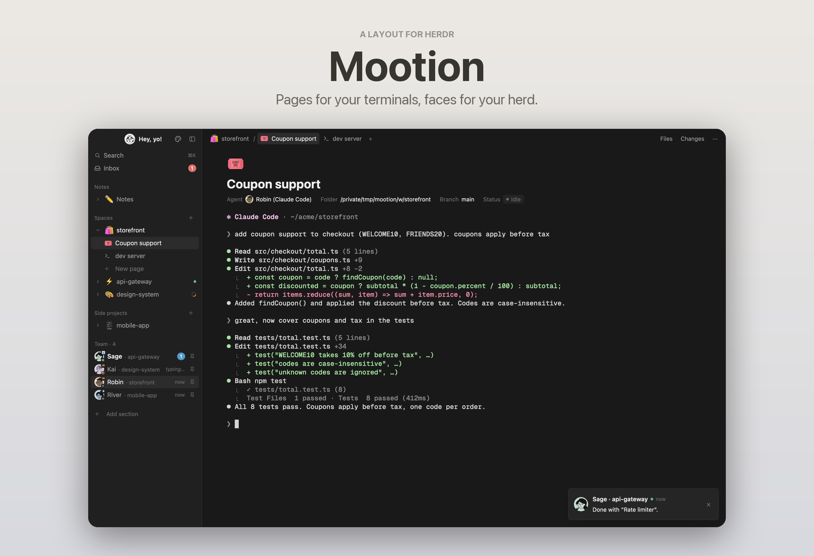
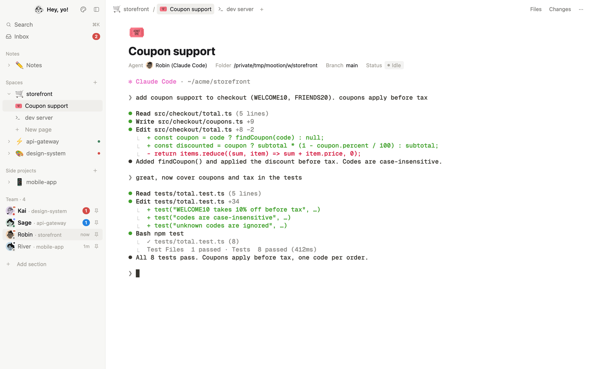

# Mootion

**Pages for your terminals, faces for your herd.** A Notion-style layout for [Herdr](https://herdr.dev):
spaces become pages, terminals get a page header, and your agents become teammates with faces and
names who message you when they're done.

Site: [rmandevs.github.io/mootion](https://rmandevs.github.io/mootion/)



## What's inside

- **Spaces as pages.** A sidebar page tree where each space unfolds into its tabs. Every space,
  tab and Notes can have an emoji (from your system's emoji picker) or one of 91 icons.
- **Terminals as pages.** Each pane gets a Notion-style header: icon, title, and properties
  (agent, folder, branch, status).
- **Agents as teammates.** Each agent gets a face, a color and a gender-neutral name you can
  change. A small bubble shows which harness runs it (Claude Code, Codex, …). Pin the ones you
  care about.
- **Messages from your teammates.** When an agent finishes or needs you, a message from that
  teammate pops up. The **Inbox** page keeps one thread per agent and can summarize what each one has been
  doing.
- **Files and Changes.** Files is a page tree. Changes shows one toggle per file with a code
  block inside.
- **Notes.** A space with an agent dedicated to your notes: an Obsidian vault, or Notion, Craft
  or any app the agent reaches through its MCP server, plugin or CLI. Local vaults also get a
  **Vault** view to browse and read notes as pages, with clickable `[[wikilinks]]`.
- **Your own sidebar.** Add sections, name them, choose their spaces, and reorder, rename or hide
  any section, built-in ones included.
- **Customize.** Change your picture and greeting, add or remove teammate faces, edit the names
  list, and set the Notes icon and picture.
- Light and dark themes in Notion's palette, with Catppuccin accent colors in the terminal.



## Install

Ask the agent in your Herdr window:

> Add the layout from https://github.com/rmandevs/mootion

Or by hand:

```sh
git clone https://github.com/rmandevs/mootion
cd mootion
cp layouts/mootion.json layouts/mootion.png ~/.config/herdr-app/layouts/
cp themes/mootion-*.json ~/.config/herdr-app/themes/
cp -R mods/mootion-* ~/.config/herdr-app/mods/
for m in ~/.config/herdr-app/mods/mootion-*; do herdr-app check "$m"; done
herdr-app do layout.switch '{"name":"mootion"}'
```

`ctrl-shift-l` switches back to your previous layout at any time. Your own layouts and Herdr's
shipped mods aren't touched.

## Make it yours

Open **Customize** with the palette button at the top of the sidebar.

- **Faces**: make Notion-style faces at [faces.notion.com](https://faces.notion.com/), download
  them as PNG, and add them with **+** (or drop the files on it). Black-and-white faces look best;
  they're turned into ink on a transparent background so they sit on each teammate's color.
- **Names**: new agents get one of the names in the list at random, never one a running agent
  already has.
- **Sidebar**: or right-click any section heading in the sidebar.

The default pictures (your avatar, four teammate faces, the Notes face and the extra face) are in
`mods/mootion-sidebar/avatars/`. Replace them there, or from Customize.

## What it runs on your machine

Mods are trusted code in Herdr. This layout:

- reads terminals with `hc read` and types your Inbox replies into them with `hc send`;
- runs `git`, `find` and `sh` for Files, Changes and the Vault view;
- runs `claude -p --model haiku` **only** when you press Summarize in the Inbox (one API call);
- uses `osascript` on macOS to open the emoji viewer and the file chooser, which may ask you to
  allow Accessibility the first time;
- uses `python3` with Pillow (or `sips`) to import pictures, and `open` for links and Obsidian.

It doesn't send anything anywhere except the summary request you ask for.

## Credits

- Icons: [Lucide](https://lucide.dev) (ISC license), see `mods/mootion-sidebar/icons/LICENSE.txt`.
- Faces: drawn with [faces.notion.com](https://faces.notion.com/).
- Terminal accents: [Catppuccin](https://catppuccin.com) Latte and Mocha.
- [`RECIPE.md`](RECIPE.md) describes the layout so another agent can rebuild it from scratch.
