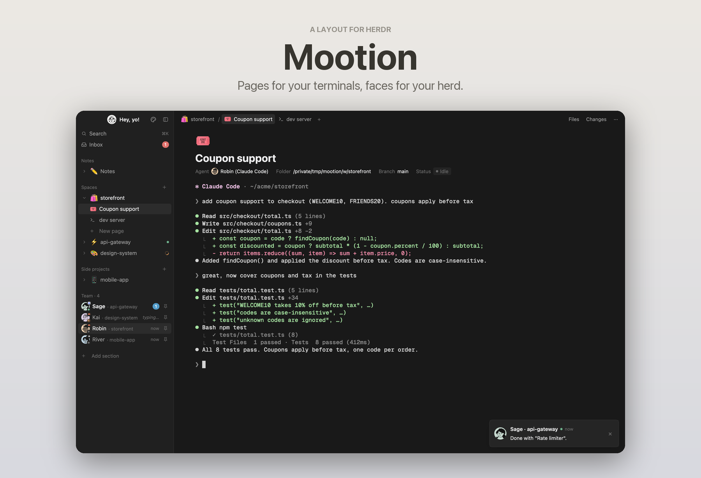

# Mootion

Pages for your terminals, faces for your herd: a Notion-style layout for Herdr. Spaces are pages in a sidebar tree, every terminal sits under a
Notion-style page header, and agents are teammates with faces and names who message you when they
finish. Files is a page tree, Changes reads like code blocks, an Inbox page keeps one thread per
agent, Notes gives you a dedicated notes agent with a vault viewer, and a Customize page lets you
change pictures, names and the sidebar's sections. Light and dark follow the system.

## What you see

Left to right:

1. **Sidebar** (256px, theme `chrome`, collapsible to a 76px rail).
   - Header block (46px, window drag): your picture (24px circle) and greeting ("Hey, yo!"),
     a palette button (opens Customize) and a sidebar toggle. Clicking the picture or greeting
     opens Herdr's settings (tooltip "See Herdr settings"); a blue dot on the picture means an
     update is waiting.
   - Search (⌘K, opens the `picker`) and Inbox (red unread badge).
   - Sections, in the order the person chose (defaults: Notes, Spaces, Team), headings 12px `dim`:
     - **Notes**: the Notes space (✏️ by default), unfolding to "Notes agent" (its face),
       "Vault" (local vaults only) and "New terminal". "Set up Notes" until it exists.
     - **Spaces**: a page tree. Each space has an emoji or lucide icon (automatic from its name),
       a chevron, its status (spinner when working, dot when done/blocked) and unfolds to its tabs
       as pages, plus "New page".
     - **Team**: every agent as a teammate: face on a pastel circle of their color, a presence dot,
       a small bubble with the harness icon (tooltip "Claude Code", …), their name, `· space`,
       "typing…" while working, a badge when done/blocked, the idle time, and a pin.
     - Own sections: a title and the spaces chosen for it.
   - "+ Add section" at the end.
2. **Top bar** (44px, window drag): breadcrumbs `space / tab   other tabs  +`, then Files,
   Changes and `···`. On the Inbox and Customize pages it reads `space / 📥 Inbox` or
   `space / 🎨 Customize`.
3. **Center** (a stack): the active tab, the Inbox page or the Customize page.
   - Each pane gets a 136px page header: big icon (36px), title (28px bold), and a property row:
     `Agent <face> Name (Harness)` or `Program`, `Folder`, `Branch`, `Status` pill.
     Terminals have 56px side margins, no card border.
4. **Right panel** (300px, hidden by default): Files or Changes, toggled only from the top bar;
   the panel shows its title and a close button.

Themes `mootion-light` (white, sidebar `#f7f7f5`, text `#37352f`, accent `#2383e2`) and
`mootion-dark` (`#191919`, sidebar `#202020`, text `#d4d4d4`, accent `#529cca`); terminal accent
colors are Catppuccin Latte / Mocha, black/white slots and background stay Notion's. UI font is
the system font (`.SystemUIFont`).

## How it behaves

- **Agent status**: working = orange spinner and "typing…"; blocked = red dot/badge and "Needs
  you"; done = blue badge; idle = grey dot and time since. Status pills use theme `working`,
  `blocked`, `done`, `idle`.
- **Toasts** (`mootion-toast` as the layout's `toast`): a message from the teammate: face, "Name ·
  space", "now", and "Done with "task"." or "I need you on "task"."; click opens the agent, × dismisses.
- **Inbox page**: teammates on the left with their last message and time; the selected thread on
  the right starts with a 💡 Summary (Summarize runs `claude -p --model haiku` over the agent's last
  400 terminal lines) followed by messages built from status changes (started, needs you, done,
  with the last lines of output). Typing in the box sends text to the agent with `hc send`.
- **Names and faces**: new agents get a random gender-neutral name and a face no other running
  agent has; once every face is taken they get the "extra" face. Double-click or right-click a
  teammate (or click the name in the Inbox or page header) to rename.
- **Icons**: click any space, tab or Notes icon for a popup with two tabs: Emoji (the system's
  picker: ⌃⌘Space on macOS, Win+. on Windows; "Open emoji viewer" asks macOS to open it) and Icons
  (91 lucide icons).
- **Sections**: right-click a heading for Rename, Choose spaces (own sections), Move up/down,
  Hide (built-ins) or Delete (own sections). A space is in one own section at most; Spaces shows
  the rest. Customize lists every section with ↑ ↓ Rename Spaces Hide/Show Delete.
- **Notes**: "Set up Notes" asks where notes live (Obsidian, Notion, Craft, Other), a folder and
  the agent, then starts a "Notes" space whose agent gets a brief as its first message. The Vault
  tab lists a local folder's Markdown notes as a tree with search and renders a note with its
  frontmatter as properties and clickable [[wikilinks]]; "Open in Obsidian" opens it there.
- **Customize page**: your picture and greeting; teammate faces (+ to add with the file chooser
  or by dropping files, × to remove), the extra face, the names list (chips, add, remove), the
  Notes icon and agent face, and the Sidebar sections. Dropped pictures become 256px ink-on-
  transparent avatars (Pillow) or a plain resize.
- Pins (`terminal.pin`) keep a teammate at the top of Team.

## Built from

- `layouts/mootion.json`: root row (`titlebar: none`, theme `{light: mootion-light, dark:
  mootion-dark}`, `terminal_padding [56, 6]`, `toast: mootion-toast`). `sidebar` column: `brand`
  block (`mootion-sidebar`, props `{part: "header"}`, window drag) and `sidebar-body`
  (`mootion-sidebar`). `work` column: `tabs` (`mootion-crumbs`, window drag), `work-body` row with
  `center` stack (`main` = `{tab: "active"}` with pane header `mootion-page` 136px, `inbox` =
  `mootion-inbox`, `customize` = `mootion-customize`) and the hidden `panel` column with the
  `panel-body` stack (`files` = `mootion-files`, `changes` = `mootion-changes`).
- Mods: `mootion-sidebar` (sections, Team, Notes, the inbox recorder; ships `avatars/` and the
  lucide `icons/`), `mootion-crumbs`, `mootion-page`, `mootion-toast`, `mootion-inbox`,
  `mootion-files` and `mootion-changes` (clones of the shipped `files`/`changes`), `mootion-emoji`,
  `mootion-rename`, `mootion-notes`, `mootion-vault`, `mootion-customize` (+ `ink.py`),
  `mootion-section`, `mootion-section-menu`, `mootion-section-spaces`. Shared helpers copied into
  the mods that need them: `team.js`, `emoji.js`, `sections.js`.
- Shared state: `notion.inbox`, `notion.summaries`, `notion.agentColors`, `notion.agentFaces`,
  `notion.agentNames`, `notion.icons`, `notion.recentEmoji`, `notion.custom`, `notion.notes`,
  `notion.sidebar`, `notion.namesV2`.
- Herdr functions: `spaces`, `agents`, `panes`, `focused`, `layout`, `theme`; `run` (`space.*`, `tab.*`,
  `pane.*`, `agent.focus`, `terminal.pin`, `layout.select/show/hide/resize`, `app.settings`,
  `mod.open`), `openOverlay`, `notify`, `setAgentOrder`, `exec`, `readTextFile`, `watchFolder`,
  `knownAgents`, `pickFolder`, `shared`/`setShared`.
- Programs it runs: `hc read` / `hc send`, `git`, `find`, `sh`, `claude -p` (only on Summarize),
  `osascript` (emoji viewer and file chooser, macOS), `python3` with Pillow and `sips` (picture
  import), `open` (links, Obsidian).
- Art: lucide icons (ISC), Notion-style faces drawn on faces.notion.com.

## Watch out

- Mods can't import another mod's code: `team.js`, `emoji.js` and `sections.js` are copied into
  each mod that uses them. Keep the copies in sync.
- Inside a `v_virtual_list` renderer, `on_click` throws; the list renders nothing. Use plain rows.
- Tooltips over small click targets can swallow clicks; the pickers select on mouse down.
- Toasts get a fixed height from the app; mod.json overlay sizes don't change it.
- `claude -p` stops waiting for stdin after 3 s and `hc read` can be slower: write the screen to a
  temp file first. `--mcp-config` is variadic: put the prompt before it.
- `line_height(n)` takes a multiplier; give text rows a fixed `h()` instead.
- `run()` returns null: Notes finds its new space by name and the ids that existed before.
- The Vault view only works on a folder on this machine (Obsidian vaults); Notion/Craft notes have
  no files here.
- Faces are black line art made transparent; they need the pastel circle behind them in dark mode.
- Summaries cost an API call each; they only run on request.

## Done when

- `herdr-app check` passes for every `mods/mootion-*` folder and `layout.switch {name: "mootion"}`
  shows the sidebar, breadcrumbs and page header with no errors in `herdr-app status`.
- Switching the system appearance swaps mootion-light / mootion-dark.
- A new space gets an automatic emoji; clicking it offers Emoji and Icons and the pick sticks.
- Starting two agents gives them different faces, colors and names; renaming one shows the new
  name in Team, the page header and the Inbox.
- An agent finishing shows a toast "Done with …" and a new message in its Inbox thread.
- Opening Changes in a repo with edits shows a toggle per file and a code block with +/− counts.
- Creating a section, adding a space to it, moving it up and hiding Team all show in the sidebar
  and the collapsed rail.
- Notes set up with an Obsidian folder shows Vault; a [[wikilink]] in a note opens the target.
